# MAR E HIJAS — Arquitectura y diseño

Sistema de Gestión de Áridos. Este documento cubre el análisis previo a la
implementación: requisitos, arquitectura, base de datos, relaciones, modelo
entidad‑relación, estructura de carpetas y los flujos de venta, pedido/entrega,
stock y cuenta corriente.

---

## 1. Análisis de requisitos

Lo que distingue a un galpón de áridos de un comercio genérico, y que guía
todas las decisiones:

| Particularidad del rubro | Decisión de diseño |
|---|---|
| Se vende a granel en m³, toneladas, medio metro, viajes, bolsas | Tabla `unidades` + `conversiones_unidades` configurables (generales o **por material**, porque la densidad de la arena no es la de la piedra). Nada fijo en el código. |
| El stock se mide en una unidad pero se vende en otra | Cada material tiene **una unidad de stock** (= su unidad de venta principal). Toda venta/entrada en otra unidad se convierte con el factor vigente y se guarda el factor usado (`factor_conversion`) para auditoría. |
| Un pedido grande no entra en un solo camión | `entregas` = **un viaje**. Un pedido puede tener varias entregas; cada una valida la capacidad del camión. |
| El flete depende de zona, distancia, camión y cantidad | `zonas_entrega` (fijo + por km + por unidad) + `tipos_vehiculo.recargo_transporte`. Se calcula por API y el vendedor puede ajustarlo. |
| Mucha venta "fiada" a constructores y corralones | Cuenta corriente por cliente con libro Debe/Haber/Saldo, límite de crédito y ventas con pago parcial. |
| El chofer trabaja desde el celular | Rol chofer con vista móvil "Mis entregas" y botón grande **ENTREGA REALIZADA**. |
| Entra material por camión del proveedor con remito | Entradas de stock con proveedor, remito, vehículo (propio o externo), costo, y cargo automático en la cuenta del proveedor si se compra a crédito. |
| Facturación ARCA a futuro | Módulo `services/facturacion/` aislado con interfaz de proveedor; tablas `comprobantes`, `tipos_comprobante`, `puntos_venta` listas. Sin integración simulada. |

## 2. Arquitectura

Arquitectura **por capas** sobre Flask (MVC adaptado):

```
Navegador (HTML + CSS + JS + Chart.js)
      │  formularios (CSRF) / fetch JSON (X-CSRFToken)
      ▼
routes/      ← Controladores (Blueprints). Validan entrada, chequean permisos,
      │        llaman servicios, renderizan plantillas. Sin SQL de negocio.
      ▼
services/    ← Lógica de negocio y TRANSACCIONES (venta, stock, caja, cta. cte.,
      │        pedidos, entregas, transporte, reportes, PDF, facturación).
      ▼
models/      ← Acceso a datos (repositorios): SQL parametrizado por entidad.
      ▼
database.py  ← Conexión PyMySQL por request, helpers query/execute,
               context manager transaction() con commit/rollback.
      ▼
MySQL (InnoDB)
```

Decisiones y por qué:

- **SQL explícito con PyMySQL en vez de un ORM.** El dominio tiene mucha
  lógica transaccional (bloquear stock con `SELECT … FOR UPDATE`, saldos, caja).
  Con SQL explícito queda claro qué se bloquea y cuándo, y el esquema MySQL es
  la fuente de verdad (`database/schema.sql`). Todas las consultas usan
  parámetros (`%s`) → sin SQL injection. PyMySQL es 100 % Python: instala en
  Windows sin compilar nada.
- **Servicios como única puerta para operaciones con efectos.** Una venta
  toca 6 tablas; hacerlo en un único servicio dentro de una transacción
  garantiza que no quede una venta sin descontar stock o sin su movimiento de
  caja.
- **Permisos granulares** (`permisos` + `roles_permisos`) en vez de chequear el
  nombre del rol. Los 4 roles vienen configurados, pero el dueño puede ajustar
  qué hace cada uno desde *Usuarios → Roles* sin tocar código.
- **API interna JSON** (`/api/...`) para lo que necesita interactividad:
  autocompletado de clientes/materiales, unidades y precios de un material,
  cotización de flete, gráficos, notificaciones.
- **Búsqueda antes que listado**: los listados grandes muestran filtros y sólo
  consultan al presionar *Buscar* (o un filtro rápido), con paginación en el
  servidor (`LIMIT/OFFSET` + `COUNT`).

### Cambios respecto a la estructura propuesta

Se mantiene la propuesta y se agregan, con motivo:

- `app/database.py` — capa de conexión/transacciones separada de `extensions.py` (que queda para Flask‑Login y CSRF).
- `app/services/facturacion/` — paquete aislado para ARCA (requisito 22).
- `app/templates/{usuarios,configuracion,historial,cuentas,partials,errors,pdf}` — módulos pedidos en el sidebar que no estaban en el árbol.
- `manage.py` — comandos `init-db`, `seed`, `crear-usuario` para instalar sin pegar SQL a mano.
- `docs/` — este documento.

## 3. Estructura de carpetas

```
mar_e_hijas/
├── app/
│   ├── __init__.py            create_app(): blueprints, errores, filtros Jinja, seguridad
│   ├── config.py              Config / DevConfig / ProdConfig (lee .env)
│   ├── extensions.py          LoginManager, CSRFProtect
│   ├── database.py            conexión PyMySQL, query/execute, transaction()
│   ├── models/                repositorios SQL por entidad
│   ├── services/              lógica de negocio (+ facturacion/)
│   ├── routes/                blueprints (auth, dashboard, ventas, …, api)
│   ├── utils/                 decoradores, validadores, paginación, fechas, formato
│   ├── templates/             Jinja2 por módulo + base.html
│   └── static/{css,js,img}
├── database/schema.sql
├── docs/ARQUITECTURA.md
├── .env.example
├── manage.py
├── requirements.txt
├── run.py
└── README.md
```

## 4. Base de datos y relaciones

38 tablas InnoDB, `utf8mb4`. Importes `DECIMAL(14,2)`, cantidades
`DECIMAL(14,3)` (nunca `FLOAT`). Restricciones `CHECK` en montos, cantidades,
descuentos y factores; `UNIQUE` en códigos, CUIT/DNI, patentes; índices en
todas las FK y en las columnas por las que se filtra (fecha, estado, nombre).

Relaciones principales:

- **usuarios N—1 roles**, **roles N—N permisos** (`roles_permisos`).
- **materiales N—1 categorias_materiales / unidades / proveedores**.
- **conversiones_unidades**: N—1 unidad origen, N—1 unidad destino, N—1 material (opcional). Único por (material, origen, destino) usando una columna generada `material_key` para que la conversión general (material NULL) tampoco se duplique.
- **clientes 1—1 cuentas_corrientes 1—N movimientos_cuenta_corriente**.
- **ventas N—1 clientes / usuarios**, **ventas 1—N detalle_ventas N—1 materiales/unidades**, **ventas 1—N pagos**, **ventas 1—N movimientos_stock**, **ventas 0..1—1 presupuesto / pedido** de origen.
- **presupuestos 1—N detalle_presupuestos**; puede derivar en una venta y/o un pedido (`venta_id`, `pedido_id`).
- **pedidos 1—N detalle_pedidos**, **pedidos 1—N entregas 1—N detalle_entregas**, pedido 0..1 venta.
- **entregas N—1 choferes / vehiculos / clientes**.
- **vehiculos N—1 tipos_vehiculo / unidades (capacidad) / choferes (asignado)**; **choferes 0..1—1 usuarios** (para la vista móvil).
- **cajas 1—N movimientos_caja**; cada movimiento referencia opcionalmente su origen (venta, pago, gasto, pago a proveedor). Una sola caja abierta garantizada por índice único sobre columna generada `abierta_flag`.
- **proveedores 1—N movimientos_cuenta_proveedor / pagos_proveedores / movimientos_stock (entradas)**.
- **comprobantes N—1 ventas / tipos_comprobante / puntos_venta**.
- **historial_operaciones N—1 usuarios**.

**Desnormalizaciones controladas** (todas cache de un libro de movimientos,
actualizadas en la misma transacción con bloqueo de fila):
`materiales.stock_actual`, `cuentas_corrientes.saldo`, `proveedores.saldo_cuenta`.
Cada movimiento guarda además el saldo resultante para reconstruir el libro
sin recalcular. Los totales de ventas/presupuestos/pedidos se guardan porque
son **documentos**: el precio del material cambia, el documento no.

## 5. Modelo entidad‑relación

```mermaid
erDiagram
    ROLES ||--o{ USUARIOS : tiene
    ROLES }o--o{ PERMISOS : roles_permisos
    CATEGORIAS_MATERIALES ||--o{ MATERIALES : clasifica
    UNIDADES ||--o{ MATERIALES : "unidad de venta/stock"
    PROVEEDORES ||--o{ MATERIALES : "provee"
    MATERIALES ||--o{ CONVERSIONES_UNIDADES : "conversión específica"
    UNIDADES ||--o{ CONVERSIONES_UNIDADES : "origen/destino"
    ZONAS_ENTREGA ||--o{ CLIENTES : ubica
    CLIENTES ||--|| CUENTAS_CORRIENTES : posee
    CUENTAS_CORRIENTES ||--o{ MOVIMIENTOS_CUENTA_CORRIENTE : registra
    CLIENTES ||--o{ PRESUPUESTOS : solicita
    PRESUPUESTOS ||--o{ DETALLE_PRESUPUESTOS : contiene
    CLIENTES ||--o{ PEDIDOS : realiza
    PEDIDOS ||--o{ DETALLE_PEDIDOS : contiene
    PEDIDOS ||--o{ ENTREGAS : "se reparte en viajes"
    ENTREGAS ||--o{ DETALLE_ENTREGAS : lleva
    CHOFERES ||--o{ ENTREGAS : maneja
    VEHICULOS ||--o{ ENTREGAS : transporta
    TIPOS_VEHICULO ||--o{ VEHICULOS : clasifica
    CHOFERES |o--o| USUARIOS : "accede como"
    CLIENTES ||--o{ VENTAS : compra
    USUARIOS ||--o{ VENTAS : registra
    VENTAS ||--o{ DETALLE_VENTAS : contiene
    MATERIALES ||--o{ DETALLE_VENTAS : "se vende en"
    VENTAS ||--o{ PAGOS : "se cobra con"
    METODOS_PAGO ||--o{ PAGOS : usa
    MATERIALES ||--o{ MOVIMIENTOS_STOCK : mueve
    VENTAS ||--o{ MOVIMIENTOS_STOCK : descuenta
    CAJAS ||--o{ MOVIMIENTOS_CAJA : registra
    PAGOS ||--o| MOVIMIENTOS_CAJA : ingresa
    GASTOS ||--o| MOVIMIENTOS_CAJA : egresa
    CATEGORIAS_GASTOS ||--o{ GASTOS : clasifica
    PROVEEDORES ||--o{ MOVIMIENTOS_CUENTA_PROVEEDOR : "cuenta"
    PROVEEDORES ||--o{ PAGOS_PROVEEDORES : cobra
    VENTAS ||--o{ COMPROBANTES : factura
    TIPOS_COMPROBANTE ||--o{ COMPROBANTES : tipo
    PUNTOS_VENTA ||--o{ COMPROBANTES : emite
    USUARIOS ||--o{ HISTORIAL_OPERACIONES : realiza
```



## 6. Unidades y conversiones

`conversiones_unidades` guarda "1 *origen* = *factor* *destino*". El servicio
`conversion_service.factor(material, desde, hacia)` busca en este orden:

1. Misma unidad → 1.
2. Conversión **específica del material** directa, o la inversa (1/factor).
3. Conversión **general** directa o inversa.
4. Un salto intermedio (ej.: viaje → m³ general y m³ → t del material).

Si no hay camino, la operación se rechaza con un mensaje claro ("Configure la
conversión Tonelada → m³ para Arena gruesa"). Así, *1 viaje = 6 m³* se carga
una vez en Configuración → Conversiones y la venta de "2 viajes de arena"
descuenta 12 m³ y se cotiza a 12 × precio del m³ (editable).

## 7. Flujo de una venta

```
Vendedor elige cliente (autocompletado) ─► agrega líneas: material, unidad, cantidad
   │   (la API devuelve unidades convertibles y el precio sugerido por unidad)
   ├─► descuento % por línea + descuento general + flete (retiro o envío por zona)
   ├─► forma de pago y monto cobrado (el resto va a cuenta corriente)
   ▼
POST /ventas/nueva  ── venta_service.registrar_venta() ── UNA transacción:
   1. Valida cliente activo, materiales activos, cantidades > 0, caja abierta si se cobra algo.
   2. Recalcula TODO en el servidor (no confía en los totales del navegador).
   3. Bloquea cada material (SELECT … FOR UPDATE), convierte a unidad de stock
      y verifica stock suficiente (configurable: permitir stock negativo = no).
   4. INSERT ventas + detalle_ventas (guarda precio, factor y costo del momento).
   5. INSERT movimientos_stock (salida) y UPDATE materiales.stock_actual.
   6. Si monto cobrado > 0: INSERT pagos + movimientos_caja (ingreso, método).
   7. Si queda saldo: valida límite de crédito, INSERT movimiento cta. cte. (DEBE)
      y UPDATE cuentas_corrientes.saldo.
   8. Si es envío: crea una entrega pendiente con los materiales.
   9. historial_operaciones: "Juan creó la venta V-000123".
   COMMIT (o ROLLBACK completo ante cualquier error).
```

Anular una venta revierte en otra transacción: stock (movimiento `anulacion`),
cuenta corriente (HABER), caja (egreso tipo `anulacion` por lo cobrado) y
cancela entregas pendientes. Nunca se borra: queda auditado.

## 8. Flujo de pedido y entrega

```
Presupuesto (opcional) ─► Pedido [pendiente]
    ─► confirmado ─► preparando ─► listo ─► en camino ─► entregado
                                          └─► cancelado (desde cualquier estado previo a entregado)

Pedido ─► "Generar venta": crea la venta con los mismos ítems/flete (descuenta stock, cobra
          o envía a cta. cte.). Se puede hacer al confirmar o al entregar, según cómo trabaje el galpón.
Pedido ─► "Programar entrega": uno o varios viajes. Cada viaje (entrega) tiene chofer,
          camión, fecha, horario y materiales. Se valida:
            · que la carga convertida a la unidad del camión no supere su capacidad;
            · que no se programe más material que lo pendiente del pedido.
Chofer (celular) ─► ve sus entregas del día ─► "Salí" (en camino) ─► ENTREGA REALIZADA
            (quién recibió) o NO ENTREGADA (motivo).
Estados del pedido se sincronizan: primer viaje en camino ⇒ pedido "en camino";
todos los materiales entregados ⇒ pedido "entregado".
```

## 9. Stock

- Stock en la unidad del material; `movimientos_stock` es el libro con signo
  (`+` entradas y ajustes positivos, `−` salidas y ajustes negativos),
  `stock_anterior` y `stock_resultante` en cada fila.
- **Entradas**: material, cantidad y unidad (se convierte), proveedor, fecha,
  vehículo (propio o descripción de camión externo), remito, costo total,
  observaciones y si se paga al contado (egreso de caja) o queda a cuenta del
  proveedor. Opcionalmente actualiza el precio de compra del material.
- **Salidas**: sólo desde ventas (con cliente, venta, usuario y fecha).
- **Ajustes**: conteo físico ("medí la pila y hay 38 m³") con motivo obligatorio.
- Alertas de stock bajo (`stock_actual <= stock_minimo`) en dashboard y
  notificaciones.
- Toda operación bloquea la fila del material para evitar carreras entre dos
  vendedores.

## 10. Cuenta corriente

- Una cuenta por cliente (se crea con el cliente). `saldo > 0` = el cliente debe.
- Movimientos: **venta** (DEBE, parte no cobrada), **pago** (HABER, entra a caja),
  **deuda** manual (DEBE), **crédito** / nota a favor (HABER), **anulación**,
  **ajuste**.
- Libro: `Fecha | Concepto | Debe | Haber | Saldo`, filtrable por fechas,
  imprimible en HTML y descargable en PDF.
- Límite de crédito opcional por cliente: una venta que lo supere se rechaza.
- Un pago a cuenta requiere caja abierta y genera el movimiento de caja con su
  método (efectivo/transferencia/…).

## 11. Caja

Una sola caja abierta. Todo cobro o pago por cualquier medio queda en
`movimientos_caja` con su método, así el cierre muestra: saldo inicial,
ventas en efectivo, transferencias, tarjetas, otros medios, ingresos, egresos,
**saldo esperado en efectivo** (inicial + ingresos en efectivo − egresos en
efectivo), saldo declarado y diferencia. El cierre congela esos totales en
`cajas` para el historial.

## 12. Facturación (ARCA/AFIP)

`app/services/facturacion/`:

- `base.py` — interfaz `ProveedorFacturacion` (`autorizar(comprobante) → ResultadoAutorizacion`, `ultimo_numero(pv, tipo)`), y dataclasses con todos los campos que exige ARCA (tipo, punto de venta, número, CUIT, condición IVA, importes, CAE y vencimiento).
- `servicio.py` — arma el comprobante desde una venta (determina letra A/B/C según condición IVA del emisor y receptor), lo guarda como *borrador* y lo envía al proveedor configurado.
- `proveedores.py` — registro de proveedores. Hoy sólo existe `SinProveedor`, que **se niega explícitamente** a autorizar. Para integrar: implementar `ArcaWSFEProveedor` (WSAA + WSFEv1 con certificado) y registrarlo en `.env` (`FACTURACION_PROVEEDOR=arca`).

## 13. Seguridad

Contraseñas con `werkzeug.security` (scrypt/pbkdf2), sesiones Flask‑Login con
cookies `HttpOnly`, `SameSite=Lax` y `Secure` en producción, CSRF en todos los
POST (formularios y `fetch`), autoescape Jinja contra XSS, cabeceras de
seguridad (CSP, X‑Frame‑Options, nosniff), consultas parametrizadas,
decoradores `@permiso_requerido`, bloqueo tras intentos fallidos de login,
manejadores centralizados 400/403/404/500 y variables sensibles en `.env`.
